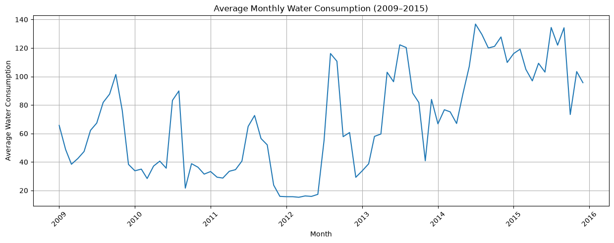
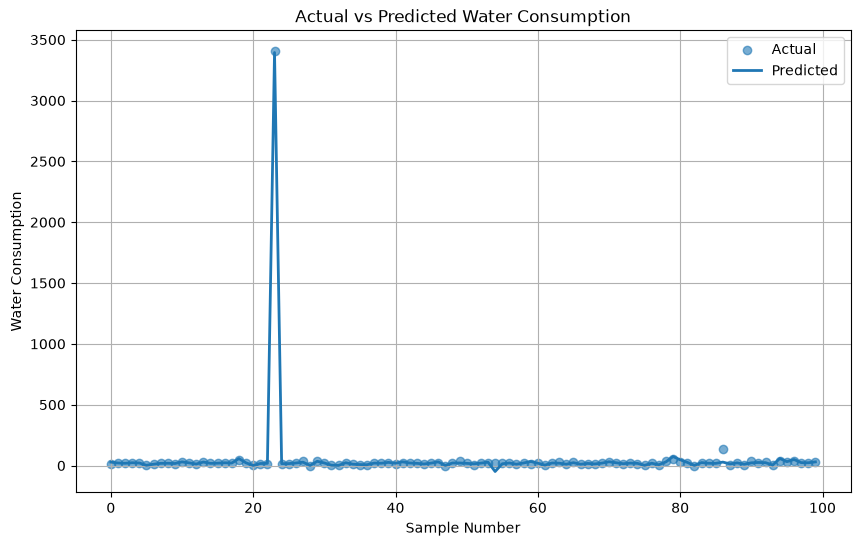
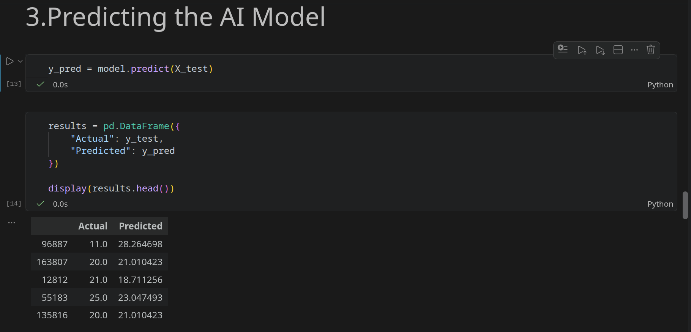

# City Water Consumption Prediction

A machine-learning mini-project that analyzes historical monthly water-consumption data and uses Linear Regression to predict water consumption for August 2009 from the previous three months.

> **Course:** AI101 Mini-Project  
> **Group:** 62

## Team and Roles

Update the table below with your team's final details before submission.

| Team Member | Entry Number | Role |
|---|---|---|
| Paramjit Singh Manko | 2026MCB1553 | Execution Lead |
| Sarthak Jain | 2026AIB1076 | Documentaion Lead |
| Banoth Karthik Kumar | 2026EEB1333 | Presentation Lead |
| Ankit Raj | 2026EEB1321 | Video Lead |


## Project Overview

Water consumption data can be studied to understand historical usage patterns and estimate future consumption. This project explores a city-level water-consumption dataset containing monthly records from January 2009 to December 2015.

The notebook performs data loading, exploration, missing-value handling, visualization, model training, prediction, and evaluation.


## Dataset

We are using the [Water Consumption Dataset](https://www.kaggle.com/datasets/marcomolina/water-consumption-in-a-median-size-city) from kaggle. The dataset is also included as "water_consumption.csv" in the repository.

The dataset has **178,597 rows and 89 columns**. The notebook identifies **84 monthly water-consumption columns**, covering January 2009 to December 2015. Rows with missing values in these monthly columns are removed before the analysis and model training. After this cleaning step, **141,205 rows** remain.

The notebook uses the following columns for its prediction task:

| Purpose | Dataset columns |
|---|---|
| Input features | `f.1_MAY_09`, `f.1_JUN_09`, `f.1_JUL_09` |
| Target | `f.1_AGO_09` |


## Project Workflow

1. **Import libraries:** Import Pandas, NumPy, Matplotlib, Seaborn, and the required Scikit-learn modules.
2. **Load and inspect data:** Read the CSV file and inspect its dimensions, column types, and contents.
3. **Identify monthly columns:** Select columns whose names begin with `f.1_`.
4. **Handle missing values:** Remove rows with missing values in the monthly consumption columns.
5. **Explore monthly trends:** Calculate and plot average consumption for each month from 2009 to 2015.
6. **Prepare features and target:** Use May, June, and July 2009 as input features and August 2009 as the target.
7. **Train the model:** Split the data into 80% training and 20% testing sets, then fit a Linear Regression model.
8. **Make predictions:** Predict August consumption for the test set.
9. **Evaluate and visualize:** Compare actual and predicted values and calculate MAE, MSE, RMSE, and R².

## Repository Structure

```text
AI-mini-project-group-62/
├── water_consumption.csv
├── water_consumption_model.ipynb
├── requirements.txt
└── README.md
```


## Setup

### Prerequisites

- Python 3.10 or newer recommended
- Git
- Jupyter Notebook

### 1. Clone the repository

```bash
git clone https://github.com/Paramjitsingh7/AI-mini-project-group-62.git
cd AI-mini-project-group-62
```

### 2. Create and activate a virtual environment

**Windows (Command Prompt):**

```bash
python -m venv venv
venv\Scripts\activate
```

**macOS / Linux:**

```bash
python3 -m venv venv
source venv/bin/activate
```

### 3. Install the required libraries

```bash
python -m pip install --upgrade pip
python -m pip install pandas numpy matplotlib seaborn scikit-learn jupyter
```

OR

```bash
pip install -r requirements.txt
```

## How to Run

1. Make sure the virtual environment is activated.
2. Start Jupyter Notebook from the repository's root directory:

   ```bash
   jupyter notebook
   ```

3. Open `water_consumption_model.ipynb`.
4. Check the CSV loading cell. Since the CSV file and notebook are in the repository root, use:

   ```python
   df = pd.read_csv("water_consumption.csv")
   ```

   If the notebook currently contains `../dataset/water_consumption.csv`, replace that path with the path above. The original relative path expects a separate `dataset` folder that is not present in the repository structure.
5. Run the notebook cells in order, from top to bottom.

## Expected Output

When the notebook runs successfully, it should produce:

- Dataset inspection and cleaning information.
- A line plot showing average monthly water consumption from 2009 to 2015.
- A table comparing actual and predicted August 2009 consumption.
- A scatter plot of actual versus predicted consumption.
- A plot comparing actual and predicted values for the first 100 test samples.
- Model evaluation metrics: MAE, MSE, RMSE, and R².

### Model Results

The notebook's currently saved output shows the following evaluation results:

| Metric | Result |
|---|---:|
| Mean Absolute Error (MAE) | 5.1660 |
| Mean Squared Error (MSE) | 213.6243 |
| Root Mean Squared Error (RMSE) | 14.6159 |
| R² Score | 0.9991 |

These values are from the notebook's saved execution output. They may vary if the dataset or model workflow is changed.

### Output Screenshot





## Presentation and Video

- **Project presentation:**
[presentation](Presentation.pptx)
- **Project video:**


## AI-Use Disclosure

AI tools were used during parts of the project workflow. ChatGPT was used by team members for understanding the dataset and its structure, clarifying Git and GitHub concepts and usage, improving the formatting and structure of the project presentation, and drafting the initial README.md file.

The team reviewed the AI-generated suggestions and used them as guidance throughout the project. AI assistance was primarily used to support learning, improve workflow efficiency, and enhance project documentation, while the team remained responsible for the final decisions and submitted work.
